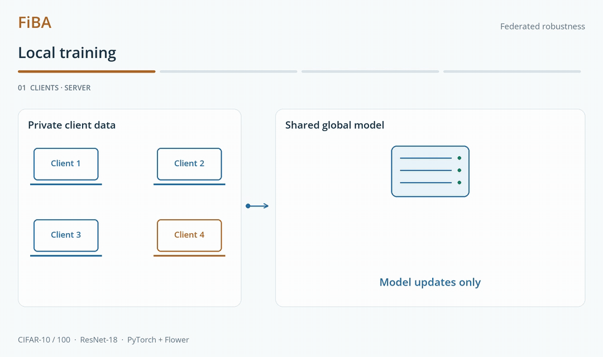

<h1 align="center">FiBA</h1>
<p align="center"><strong>On the Effectiveness of Invisible Backdoor Attacks in Federated Learning</strong></p>
<p align="center">Mattjis Marinus · <a href="https://vtsouval.github.io/"><strong>Vasileios Tsouvalas</strong></a> · Nirvana Meratnia</p>

<p align="center">
  <a href="https://doi.org/10.1007/978-981-96-4836-8_13" title="Read the paper"></a>
  <picture></picture>
  <a href="https://nousphera.github.io/projects/fiba/" title="Explore the project"></a>
  <picture></picture>
  <a href="https://nousphera.github.io/assets/posters/fiba-a0-landscape.pdf" title="View the poster"></a>
</p>

## Abstract

**FiBA** examines *invisible backdoor attacks* in **Federated Learning (FL)**: malicious clients embed subtle triggers during local training, while the server combines their updates with those of honest clients. The benchmark compares **LSB, WaNet, Encoder and LIRA** against the visible *BadNet* baseline, measuring **clean accuracy, attack success and detectability** on CIFAR-10 and CIFAR-100. Experiments vary *malicious participation* and *robust aggregation*, and investigate **low-attention trigger placement**. The results show that attack effectiveness depends on the federated setting—and that increased success can also make a trigger easier to detect.

<p align="center">
  <picture>
    <source media="(max-width: 600px) and (prefers-color-scheme: dark)" srcset="docs/assets/readme/method-dark-mobile.gif">
    <source media="(max-width: 600px)" srcset="docs/assets/readme/method-light-mobile.gif">
    <source media="(prefers-color-scheme: dark)" srcset="docs/assets/readme/method-dark.gif">
    
  </picture>
</p>

## Setup

Create and activate the `fiba` environment:

```bash
git clone https://github.com/Nousphera/FiBA.git
cd FiBA
python3.12 -m venv --prompt fiba "$HOME/.venvs/fiba"
source "$HOME/.venvs/fiba/bin/activate"
```

From the activated `fiba` environment, install the requirements:

```bash
python -m pip install -r requirements.txt
```

## Data and Weights

Download, prepare and validate [CIFAR](https://www.cs.toronto.edu/~kriz/cifar.html):

```bash
# CIFAR-10
python scripts/prepare_data.py --dataset cifar10

# CIFAR-10 and CIFAR-100
python scripts/prepare_data.py
```

### Prepare Model

The CIFAR **ResNet-18** trains from scratch. Encoder and LIRA additionally require a shared trigger generator:

```bash
python scripts/prepare_model.py --attack encoder --dataset cifar10
python scripts/prepare_model.py --attack lira --dataset cifar10
```

Generator checkpoints are selected automatically from `checkpoints/`; use `--generator-checkpoint` to select another.

## Run Experiments

From the repository root, run a **Flower App**:

```bash
common=(--dataset cifar10 --nr-clients 10 --rounds 100 --local-epochs 5 \
        --batch-size 64 --split dirichlet --alpha 0.5 --learning-rate 0.001 \
        --attacker-fraction 0.1 --poison-fraction 0.5 --target-class 5)

# Clean FedAvg
python scripts/run_experiment.py "${common[@]}" --attack none

# Visible baseline
python scripts/run_experiment.py "${common[@]}" --attack badnet

# Invisible attacks
python scripts/run_experiment.py "${common[@]}" --attack lsb
python scripts/run_experiment.py "${common[@]}" --attack wanet
python scripts/run_experiment.py "${common[@]}" --attack encoder
python scripts/run_experiment.py "${common[@]}" --attack lira
```

Compare server defenses with the same data and client partitions:

```bash
for defense in median trimmed-mean foolsgold krum multi-krum; do
  python scripts/run_experiment.py "${common[@]}" --attack lsb \
    --aggregation "$defense" --byzantine-clients 1 --krum-keep 3
done
```

Evaluate attention-guided LSB placement:

```bash
python scripts/run_experiment.py "${common[@]}" --attack lsb \
  --attention low --attention-start-round 20 --output results/lsb-low
```

> [!NOTE]
> Each round saves **clean accuracy**, **non-target attack success rate** and the evaluated model to `results/<run>/`. Training uses the original CIFAR ResNet-18 and resets Adam each local round. Attention starts at round 20; an optional `--rankme-threshold` adds a convergence gate.

<details>
<summary><strong>Additional Settings</strong></summary>

Use `--dataset cifar100` for CIFAR-100, `--split iid` for IID clients, or `--attacker-fraction 0.2` for two attackers. `--distributed` assigns one trigger segment per attacker; `--model-replacement` scales updates at rounds 30, 60 and 90. `--byzantine-clients` sets the assumed attacker bound for Krum; FoolsGold accumulates classifier updates by client identity. `--parallel-clients` controls Flower concurrency. `--backend sequential` runs the same training loop in one process. Use `--help` for all settings.

For weighted Encoder placement, derive a mask from a trained model and prepare its generator:

```bash
python scripts/prepare_model.py --attack encoder \
  --attention-checkpoint results/none-cifar10-fedavg-seed42/checkpoint.pt \
  --attention low --output checkpoints/encoder-low.pt
python scripts/run_experiment.py "${common[@]}" --attack encoder --attention low \
  --generator-checkpoint checkpoints/encoder-low.pt --output results/encoder-low
```

The Encoder uses the same saved mask during preparation and evaluation. Generator architecture, pretraining settings and mask provenance are recorded with its checkpoint.

</details>

### Detectability

Measure perceptual distance and reconstruct potential triggers with **Neural Cleanse**:

```bash
python scripts/evaluate_detectability.py results/lsb-cifar10-fedavg-seed42/checkpoint.pt
```

LPIPS weights download on first use. Neural Cleanse saves per-class reconstructions, convergence status and anomaly scores alongside its settings.

## Citation

```bibtex
@inproceedings{marinus2025invisible,
  title     = {On the Effectiveness of Invisible Backdoor Attacks in Federated Learning},
  author    = {Marinus, Mattjis and Tsouvalas, Vasileios and Meratnia, Nirvana},
  booktitle = {Ubiquitous Security: UbiSec 2024},
  pages     = {174--190},
  year      = {2025},
  doi       = {10.1007/978-981-96-4836-8_13}
}
```

[GPL-3.0](LICENSE) · [Component terms](licenses/THIRD_PARTY.txt)
