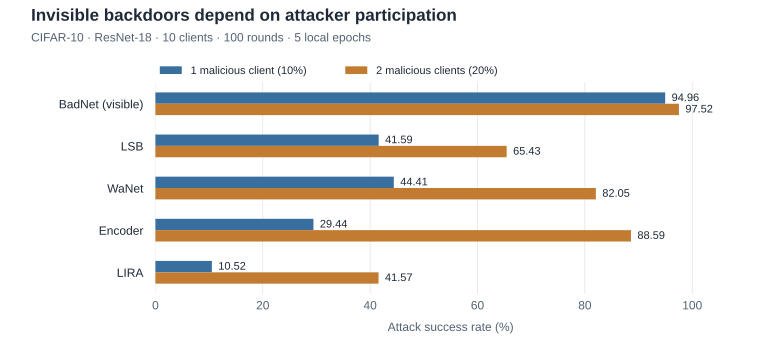

# FiBA

**On the Effectiveness of Invisible Backdoor Attacks in Federated Learning**

Mattjis Marinus, Vasileios Tsouvalas, Nirvana Meratnia<br>
UbiSec 2024 · Proceedings published in 2025

[ Paper](https://doi.org/10.1007/978-981-96-4836-8_13) · [ Project](https://nousphera.github.io/projects/fiba/) · [ Poster](https://nousphera.github.io/assets/posters/fiba-a0-landscape.pdf) · [Citation](#citation)

## Abstract

Invisible backdoor attacks aim to alter a federated model’s behavior using subtle input triggers. FiBA studies how local training and model aggregation affect these attacks, evaluates attack success alongside clean accuracy, and compares aggregation defenses. It also investigates placing triggers in regions of low model attention. The implementation provides configurable attacks, defenses, client partitions, and training schedules for CIFAR-10 and CIFAR-100.

<picture>
  <source media="(prefers-color-scheme: dark)" srcset="docs/assets/readme/attack-success-dark.svg">
  <source media="(prefers-color-scheme: light)" srcset="docs/assets/readme/attack-success-light.svg">
  
</picture>

*Attacker participation changes the outcome. Published CIFAR-10 means from [Table 1](https://pure.tue.nl/ws/portalfiles/portal/349909542/FinalPaper.pdf#page=10); ResNet-18, 10 clients, 100 rounds, 5 local epochs, Dir(0.5), target class 5. The Results table also reports clean accuracy and the source’s ± values.*

## Installation

Use Python 3.11 and a dedicated virtual environment. The Flower simulation uses Flower 1.13.1 and Ray 2.10.0. Create both the checkout and environment on paths without spaces so Ray can start its workers.

```bash
mkdir -p "$HOME/research-code" "$HOME/.venvs"
cd "$HOME/research-code"
git clone https://github.com/Nousphera/FiBA.git
cd FiBA
python3.11 -m venv "$HOME/.venvs/fiba"
source "$HOME/.venvs/fiba/bin/activate"
python -m pip install -e '.[test]' -r requirements-simulation.txt
python -m pip check
```

## Data

```bash
python scripts/prepare_data.py --dataset cifar10 --root datasets --download
python scripts/prepare_data.py --dataset cifar10 --root datasets --validate
```

Use `cifar100` for CIFAR-100. The [dataset guide](docs/DATA_SETUP.md) also covers
validated NPZ imports. Encoder attacks require a trained encoder checkpoint;
LIRA requires a TorchScript generator. Their training and export commands are
in the [experiment guide](docs/EXPERIMENTS.md).

## Training

Start a two-round local Flower simulation with two clients and one attacker,
using generated training and evaluation images:

```bash
flwr run .
python scripts/check_run.py runs/flower-smoke --rounds 2
```

Run the LSB700 configuration on CIFAR-10:

```bash
flwr run . paper --run-config 'options="--dataset cifar10 --data-root datasets --num-clients 10 --num-rounds 100 --local-epochs 5 --batch-size 64 --data-split noniid --skewness .5 --participation 1 --lr .001 --attacker-fraction .1 --target-class 5 --attack steg --trigger-characters 700 --avg-strategy avg --seed 42 --device cpu --output runs/cifar10-lsb700-seed42"'
```

The [experiment guide](docs/EXPERIMENTS.md) lists attacks, defenses, attention
placement, and generator requirements. For CUDA, select `--device cuda:0` and
configure Flower's GPU resources in `pyproject.toml`. The sequential runner
accepts the same training options:

```bash
fiba --dataset synthetic --num-clients 2 --num-rounds 2 --local-epochs 1 \
  --batch-size 4 --attacker-fraction .5 --target-class 1 --output runs/sequential
```

## Evaluation

Each round evaluates clean test accuracy and attack success rate (ASR). ASR is
the fraction of triggered, non-target test samples predicted as the target
class. Flower outputs place both values in `rounds[].metrics`; the sequential
runner uses `rounds[].accuracy` and `rounds[].asr`. Values are fractions.

```bash
python -m json.tool runs/cifar10-lsb700-seed42/results.json
```

Use a new output directory for each attack, defense, or seed. The
[experiment guide](docs/EXPERIMENTS.md) documents the supported attack–defense
settings and the separate Encoder/LIRA model requirements.

## Configuration and outputs

Use a new output directory for each run. `results.json` stores configuration,
versions, participating clients, example counts, clean accuracy, and attack
success rate (ASR), both expressed as fractions. ASR excludes the target class.
`final-parameters.npz` stores evaluated model parameters and batch-normalization
state. Optimizer and private client state are initialized for each new run.

The local Flower simulation preserves client caches across worker calls and
keys FoolsGold history by logical client identity. Set the federation's
`options.num-supernodes` to match `--num-clients`; `options` replaces the full
training argument string. See [Flower execution](docs/FLOWER_APP.md).

Implementation settings include a four-pixel BadNet trigger, attention-mask
extraction at round 20, and an external LIRA generator with perturbation scale
0.1. These and the supported aggregation rules are specified in
[EXPERIMENTS.md](docs/EXPERIMENTS.md). See [testing](docs/TESTING.md) for checks.

## Results

Reported CIFAR-10 / ResNet-18 results from [Table 1 of the accepted manuscript](https://pure.tue.nl/ws/portalfiles/portal/349909542/FinalPaper.pdf#page=10): ten clients, 100 rounds, five local epochs, Dirichlet concentration 0.5, target class 5. One or two malicious clients correspond to 10% or 20% attackers. Values are percentages.

| Attack | Clean accuracy (10% attackers) | ASR (10% attackers) | ASR (20% attackers) |
| --- | --- | --- | --- |
| BadNet (visible) | 84.00 ± 0.31 | 94.96 ± 0.81 | 97.52 ± 0.40 |
| LSB | 83.37 ± 0.33 | 41.59 ± 6.19 | 65.43 ± 3.93 |
| WaNet | 83.33 ± 0.31 | 44.41 ± 3.50 | 82.05 ± 3.59 |
| Encoder | 83.44 ± 0.27 | 29.44 ± 5.90 | 88.59 ± 4.01 |
| LIRA | 83.71 ± 0.41 | 10.52 ± 1.22 | 41.57 ± 4.66 |

All attacks gain ASR with greater malicious participation. The ± values are retained as reported; the manuscript does not identify their dispersion statistic.

## Citation

If you use this work, please cite:

```bibtex
@inproceedings{marinus2025invisible,
  title = {On the Effectiveness of Invisible Backdoor Attacks in Federated Learning},
  author = {Marinus, Mattjis and Tsouvalas, Vasileios and Meratnia, Nirvana},
  booktitle = {Ubiquitous Security: 4th International Conference, UbiSec 2024, Revised Selected Papers},
  series = {Communications in Computer and Information Science},
  volume = {2469},
  pages = {174--190},
  year = {2025},
  publisher = {Springer},
  doi = {10.1007/978-981-96-4836-8_13},
  url = {https://doi.org/10.1007/978-981-96-4836-8_13}
}
```

Machine-readable metadata: [CITATION.cff](CITATION.cff) · [BibTeX](citation.bib).

## License

[GPL-3.0-only](LICENSE), with component terms in [licenses/THIRD_PARTY.txt](licenses/THIRD_PARTY.txt). Paper and poster assets retain their own rights.
